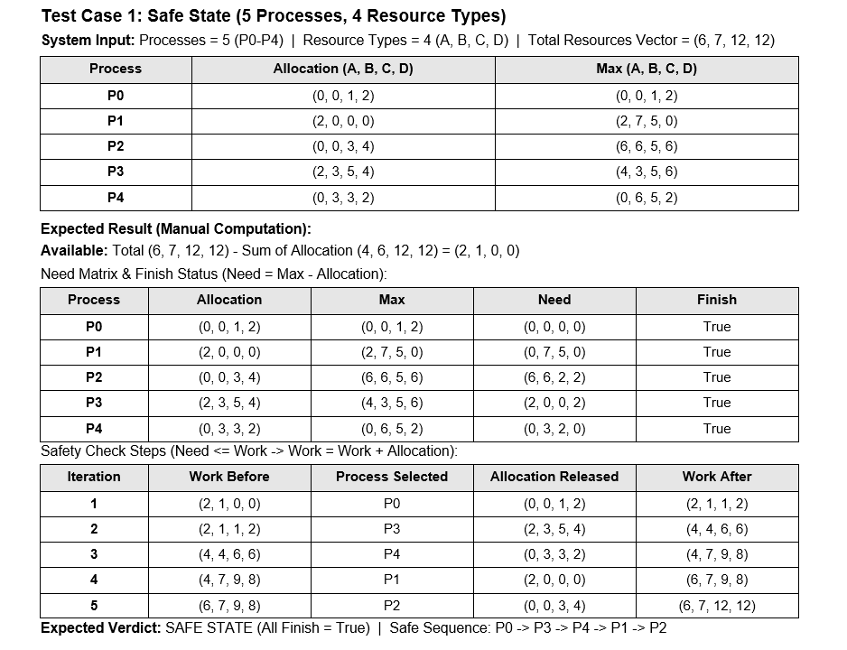
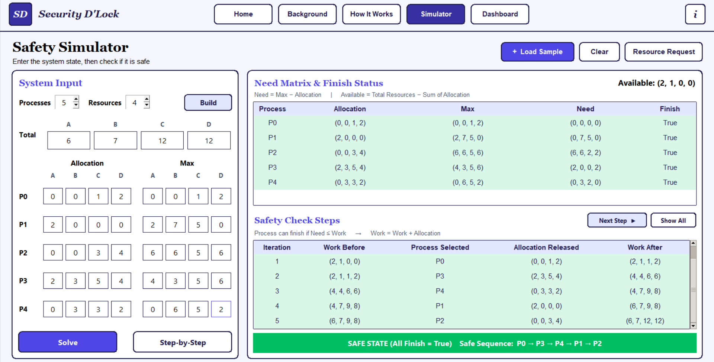
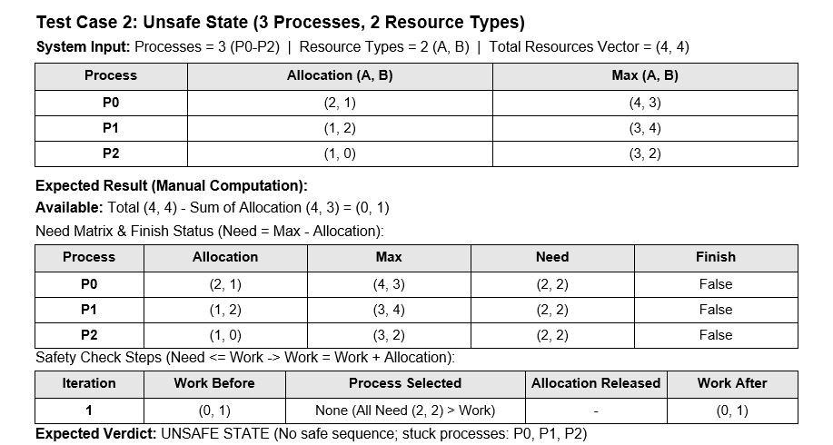
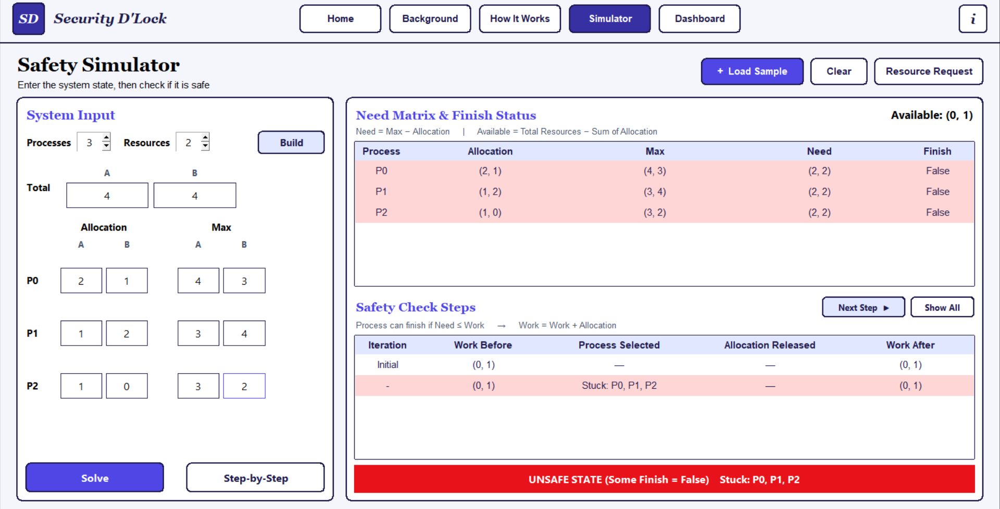
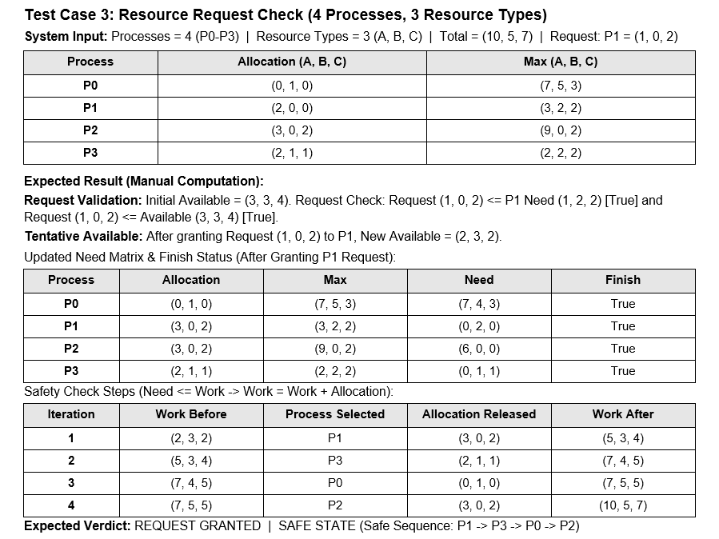
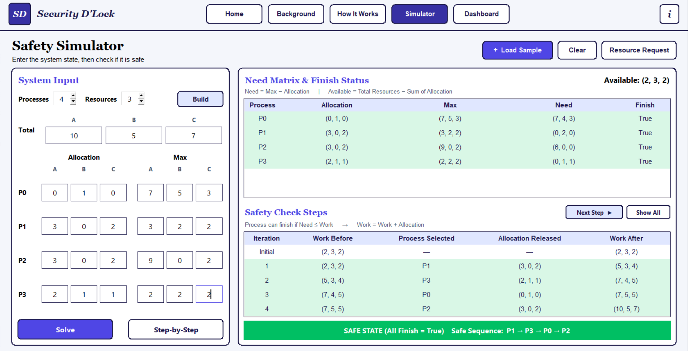

<div align="center">


### Interactive Banker’s Algorithm & Deadlock Avoidance Simulator


*A desktop simulation tool built for **PT 101 – Platform Technologies** that visualizes how operating systems allocate finite resources safely and prevent deadlocks using Edsger Dijkstra’s Banker’s Algorithm.*

</div>

---

## 📌 Overview

In multiprogramming operating systems, competing processes can enter a **deadlock** if resources are granted without checking future needs. **Security D’Lock** turns the mathematical rules of the **Banker’s Algorithm** into an interactive, visual workspace where students and instructors can configure custom process-resource matrices, trace safety sequences step-by-step, test dynamic resource requests, and inspect system-wide allocation analytics.

### ✨ Key Features
* **Scalable System Matrix (`1×1` up to `10×10`):** Dynamically builds `Total`, `Allocation`, and `Max` input grids supporting up to **10 processes (`P0–P9`)** and **10 resource types (`A–J`)**, with adaptive layout and scrollbars.
* **Dual Execution Modes:**
  * **Instant Solve:** Computes `Need`, `Available`, and the complete `Safety Check Steps` in one click.
  * **Step-by-Step Trace:** Reveals each iteration one process at a time (`Next Step ▶`), updating `Work` vectors and process `Finish` states live.
* **Resource Request Simulator:** Evaluates whether an incoming resource request satisfies `Request ≤ Need` and `Request ≤ Available`, tests the tentative state for safety, and applies approved requests directly to the table.
* **Visual Analytics Dashboard:** Summarizes resource utilization, per-process allocation vs. remaining need, and system safety status.
* **Built-In Learning Modules:** Includes dedicated **Background**, **How It Works**, and **About** pages for guided classroom walkthroughs.

---

## 🗂️ Project Structure

```text
PT_FinalProject_Group3/
├── docs/
│   └── screenshots/
│       ├── banner.png
│       ├── tc1_1_safe_state_5x4_simulator.png
│       ├── tc1_2_safe_state_5x4_dashboard.png
│       ├── tc2_1_unsafe_state_3x2_simulator.png
│       ├── tc2_2_unsafe_state_3x2_dashboard.png
│       ├── tc3_1_resource_request_4x3_popup.png
│       └── tc3_2_resource_request_4x3_updated.png
├── src/
│   ├── main.py              # Application entry point & navigation controller
│   ├── banker_logic.py      # Core Banker's Algorithm (Need, Available, Safety & Request checks)
│   ├── theme.py             # Custom UI components, color palette, and typography
│   └── pages/
│       ├── base.py          # Base page template
│       ├── home.py          # Landing page
│       ├── background.py    # Deadlock & Banker's Algorithm concepts
│       ├── how_it_works.py  # Step-by-step formula & algorithm guide
│       ├── simulator.py     # Main Safety Simulator & Resource Request dialog
│       ├── dashboard.py     # Summary metrics & visual charts
│       └── about.py         # Project & team information
├── Notes.txt
└── README.md
```

---

## 🚀 Getting Started

### Prerequisites
* **Python 3.10 or higher** (uses standard library `tkinter` and `ttk` — no external pip packages required).

### Installation & Running the App
1. **Clone the repository:**
   ```bash
   git clone [https://github.com/Charisse-Bagsit/PT_FinalProject_Group3.git](https://github.com/Charisse-Bagsit/PT_FinalProject_Group3.git)
   cd PT_FinalProject_Group3
   ```
2. **Launch the simulator:**
   ```bash
   python src/main.py
   ```

---

## 📖 User Guide

1. **Configure System Dimensions:** On the **Simulator** tab, set the number of **Processes (`1–10`)** and **Resources (`1–10`)**, then click **Build** *(or click **+ Load Sample** for a quick preset)*.
2. **Enter Resource Vectors:**
   * **Total:** Total existing instances of each resource (`A, B, C, ...`).
   * **Allocation:** Resources currently held by each process (`P0, P1, ...`).
   * **Max:** Maximum demand of each process (`Allocation ≤ Max`).
3. **Run the Safety Check:**
   * Click **Solve** to view the complete `Need Matrix`, `Safety Check Steps`, and `Safe Sequence` immediately.
   * Click **Step-by-Step** and press **Next Step ▶** to trace each iteration manually.
4. **Test a Resource Request:** Click **Resource Request**, select a process, enter the requested units, and click **Check Request** to verify if granting it keeps the system safe.
5. **Inspect the Dashboard:** Switch to the **Dashboard** tab to review overall resource usage and process completion charts.

---

## 🧪 Testing Evidence

The simulator was validated across multiple matrix dimensions and algorithm scenarios (`Safe State`, `Unsafe State`, and `Resource Request`).

### Test Case 1: Safe State (`5 Processes × 4 Resource Types`)
* **Input:** `Total = (6, 7, 12, 12)` | `5 Processes (P0–P4)` | `4 Resources (A–D)`
* **Expected Result:** `Available = (2, 1, 0, 0)` → **SAFE STATE** (`Sequence: P0 → P3 → P4 → P1 → P2`)
* **Actual Result:** **PASSED**

| Expected Output | Security D'Lock Result |
| :---: | :---: |
|  |  |

---

### Test Case 2: Unsafe State / Deadlock Risk (`3 Processes × 2 Resource Types`)
* **Input:** `Total = (4, 4)` | `3 Processes (P0–P2)` | `2 Resources (A–B)`
* **Expected Result:** `Available = (0, 1)` → **UNSAFE STATE** (`Stuck: P0, P1, P2`)
* **Actual Result:** **PASSED**

| Expected Output | Security D'Lock Result |
| :---: | :---: |
|  |  |

---

### Test Case 3: Resource Request Validation (`4 Processes × 3 Resource Types`)
* **Input:** `Total = (10, 5, 7)` | `Request: P1 → (1, 0, 2)`
* **Expected Result:** `Request ≤ Need` & `Request ≤ Available` → **REQUEST GRANTED** (`Sequence: P1 → P3 → P0 → P2`)
* **Actual Result:** **PASSED**

| Expected Output | Security D'Lock Result |
| :---: | :---: |
|  |  |

---

## 👥 Project Team (Group 3)

**Batangas State University – The National Engineering University (Alangilan Campus)**  
*College of Informatics and Computing Sciences — PT 101: Platform Technologies*

* **Charisse Bagsit**
* **Erikka Stephanie Dela Roca**
* **John Carlo Plantilla**
* **Princess Khaila Robines**
* **Joshua Servando**

**Course Facilitator:** Mr. Gerald James Q. Daño
